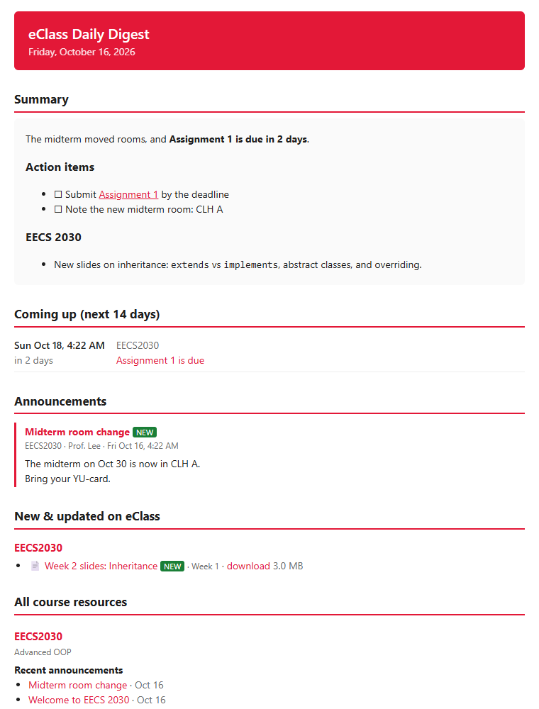
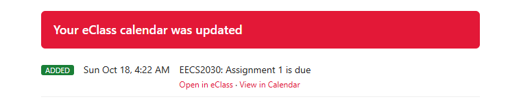

# eClass Daily Digest

A free tool for York University students. Every morning it reads your **eClass** courses and:

- **emails you a digest** listing what's due in the next two weeks, new announcements in full, new slides, files and
  activities, and a linked index of everything in every course.
- **adds every deadline, quiz and exam to Google Calendar.** It also updates them when due dates change and removes them when they're deleted.
- **emails you when your calendar changes** (new deadline, rescheduled, removed).
- *(optional)* starts each digest with an **AI-written summary and to-do list**.

<p align="center">
  
  <br>
  <br><sub>Example emails (made-up course data)</sub>
</p>

It uses eClass's official mobile-app API (the same one the Moodle app uses), so it doesn't break when the
website changes. You log in with Passport York + Duo **once**, during setup.

**Cost: free.** Gmail, Google Calendar, GitHub and the optional AI summary (Google Gemini's free tier) are all
free for this.

## Setup (about 15 minutes)

You need [Python 3.10+](https://www.python.org/downloads/) (on Windows, tick *"Add python.exe to PATH"* while installing),
a personal Gmail account, and your eClass login.

**1. Download the project.** Click **Code → Download ZIP** and unzip it, or run:
```
git clone https://github.com/FelexHill7/eclass-digest.git
```

**2. Install.** Open a terminal in the project folder.

Windows:
```powershell
python -m venv .venv
.venv\Scripts\pip install -r requirements-setup.txt
.venv\Scripts\python scripts\setup_wizard.py
```
macOS / Linux:
```bash
python3 -m venv .venv
.venv/bin/pip install -r requirements-setup.txt
.venv/bin/python scripts/setup_wizard.py
```

**3. Follow the wizard.** It walks you through each step, tests it as you go, and you can re-run it anytime:

| Step | What you do |
|---|---|
| eClass | A browser opens; log in as usual. Your eClass token is captured and saved. |
| Recipient | The address the digest goes to (usually your `@my.yorku.ca`). |
| Gmail | Make a Gmail [app password](https://myaccount.google.com/apppasswords) so the digest can be sent. |
| Calendar | Make a free Google Cloud "service account" (a robot account) and share one calendar with it. |
| AI summary | Optional. Paste a free [Gemini key](https://aistudio.google.com/apikey), or press Enter to skip. |
| Schedule | Sends your first digest and sets it to run every morning. |

That's it. On Windows it runs from Task Scheduler. If your PC is asleep at the scheduled time, it runs when the PC wakes.

<details>
<summary><b>Run it in the cloud with GitHub Actions</b> (works even when your computer is off)</summary>

1. On this repo's GitHub page, click **Use this template → Create a new repository** and make it **Private**.
   It has to be private, because workflow logs on a public repo are public.
2. Clone your private copy, then run the setup wizard in it (steps 2–3 above) so `.env` and `service_account.json` work locally.
3. Install the [GitHub CLI](https://cli.github.com), run `gh auth login`, then:
   ```
   python scripts/push_github_secrets.py
   ```
   This copies your settings into the repo's encrypted secrets and switches the workflow on. It then runs
   daily at 7 AM Toronto time. You can also start a run from the **Actions** tab.

The workflow does nothing until `DIGEST_ENABLED` is set, so copies of this repo never run by accident.
</details>

## Settings

Everything is in `.env`, which the wizard writes for you. See [.env.example](.env.example) for the full list.

| Setting | Default | What it does |
|---|---|---|
| `DIGEST_TO` | | Where the digest goes |
| `EXCLUDE_COURSES` | | Skip courses whose name contains any of these (comma-separated) |
| `DEADLINE_WINDOW_DAYS` | `14` | How far ahead "Coming up" looks |
| `NOTIFY_CALENDAR_CHANGES` | `true` | Email when deadlines are added, moved or removed |
| `SEND_IF_NOTHING_NEW` | `true` | Still email on quiet days |
| `INCLUDE_FULL_INDEX` | `true` | Add a linked index of every course to each digest |
| `DOWNLOAD_FILES` | `false` | Keep a copy of every course file in `downloads/` |
| `ECLASS_URL` | `https://eclass.yorku.ca` | Works with other Moodle sites too |

Command line: `python -m eclass_digest [--dry-run] [--no-email] [--no-calendar] [--no-ai] [--reset]`.
`--dry-run` saves a preview to `output/` without sending anything.

**Lecture notes for a whole course** (one-off): reads every lecture PDF, including diagrams and equations, and emails study notes:
```
python scripts/summarize_course.py "CSSD 3131" --match lecture
```

## Troubleshooting

- **No email?** Check spam. Also check that `DIGEST_TO` is your exact address; York addresses often include a number (e.g. `jsmith7@`).
- **"App passwords: the setting is not available"** → turn on 2-Step Verification first. If you're signed in to your school
  account, switch to a personal Gmail; York blocks app passwords on school accounts.
- **The robot can't write to the calendar (403)** → in the calendar's sharing settings, change the robot's permission to
  **Make changes to events**. If that option is greyed out, the calendar belongs to a school account; create it in a personal Gmail.
- **Calendar shows nothing**:
  - Most deadlines are at **11:59 PM**, so scroll down, or use Month or Schedule view.
  - If the calendar lives in another account, accept the share invitation and make sure it's ticked under *Other calendars*.
  - If you have two calendars with the same name, check you're looking at the shared one.
  - "Create" in Google Calendar makes an *appointment schedule*, not a calendar. Use *Other calendars → + → Create new calendar*.
- **Some courses are skipped** → eClass lists some sections (often labs) that students can't open. They're skipped automatically.
- **"Please refresh your eClass token" email** → run `scripts/get_eclass_token.py` (or the wizard) again, and re-run
  `push_github_secrets.py` if you use GitHub Actions.
- Logs are in `logs/eclass_digest.log`.

## Privacy & security

- Everything runs on **your** computer or **your** private GitHub repo. Nothing is sent anywhere else, except the
  optional AI summary, which sends course material to the AI you chose. On Gemini's **free tier, Google may use
  that content to improve its products**. Leave the key out, or use a paid Gemini key, if that matters to you.
- Email links are normal eClass links with no token in them, so forwarding a digest doesn't give anyone access.
- `.env`, `service_account.json` and `token.json` hold your secrets. They're git-ignored; never commit or share them.
  Anyone with your eClass token can read your eClass.

## For developers

```
pip install -r requirements-setup.txt
python -m pytest tests            # offline; uses a fake eClass
```

| Module | Job |
|---|---|
| [moodle.py](eclass_digest/moodle.py) | Moodle web-service client |
| [collect.py](eclass_digest/collect.py) | Courses, sections, files, announcements, events; diffing against last run |
| [files.py](eclass_digest/files.py) | Downloads and text extraction (PDF, PPTX, DOCX) |
| [ai.py](eclass_digest/ai.py) | Gemini API calls, with fallback models and rate-limit waits |
| [summarize.py](eclass_digest/summarize.py) | Daily summary prompt |
| [gcal.py](eclass_digest/gcal.py) | Google Calendar sync |
| [emailer.py](eclass_digest/emailer.py) | Email rendering and sending |

Pull requests welcome.

*Not affiliated with or endorsed by York University. You're responsible for using it in line with York's
policies; it only reads what your own account can already see.*

## License

[MIT](LICENSE)
